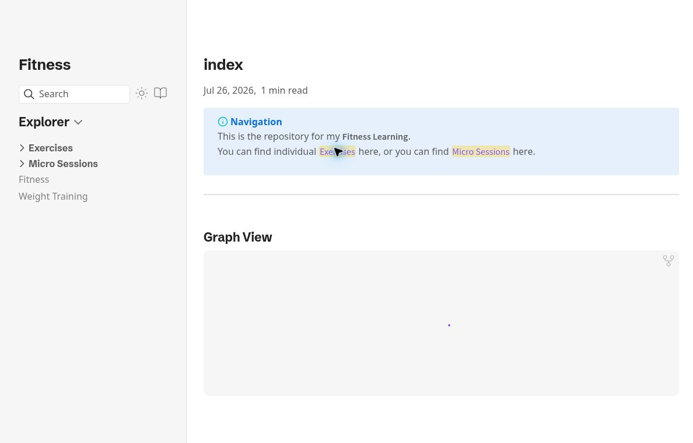
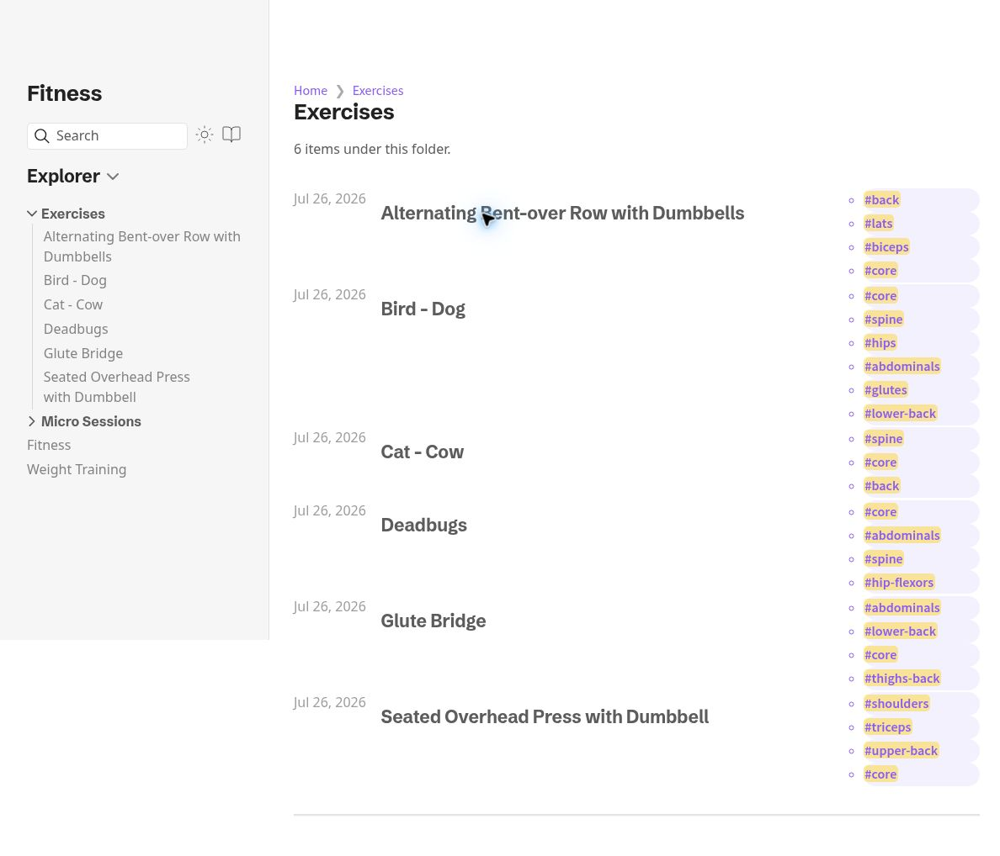

# Fitness Learning

**A connected note library for exploring exercise references and short-session ideas.**

This repository publishes a fitness-learning collection with Quartz. Its home page links the Exercises and Micro Sessions sections, while search, outlines, and related-note navigation help readers move through the material.

[Visit the notes](https://fitness.arrangedgodly.com/) · [Content index](content/index.md) · [Run locally](#run-locally)



*The home page provides entry points into the note collection.*

> This is a personal learning/reference project, not a clinically validated training program or individualized health advice. The README documents the website, content organization, and publishing workflow. It does not assess whether an exercise or routine is appropriate for a particular person.

## Browse the collection

| Entry point | Purpose |
|---|---|
| **Exercises** | Browse exercise-reference notes |
| **Micro Sessions** | Explore short-session material |
| **Search** | Locate indexed notes without knowing their folder |
| **Explorer and related links** | Follow the collection’s structure and connections |

The configuration also enables a graph, backlinks, table of contents, page previews, dark mode, and reader mode. Those are features of the Quartz publishing interface, rather than a custom workout-tracking backend.



*An index view presents the notes as a browsable reference collection.*

## Run locally

Use **Node.js 22+** and **npm 10.9.2+**, as declared by the package. The repository’s default working branch is **`v5`**.

```sh
git clone --branch v5 https://github.com/Arrangedgodly/fitness.git
cd fitness
npm ci
npx quartz build --serve
```

The preview normally serves at `http://localhost:8080`; use the address printed by the command if it differs. The existing site is already initialized, so there is no need to run the new-site creation wizard.

`npm ci` installs the dependencies pinned in `package-lock.json`. The separate `quartz.lock.json` currently contains no Git-managed plugins.

| Command | Purpose |
|---|---|
| `npx quartz build --serve` | Build and preview the default `content/` collection |
| `npx quartz build` | Generate the static site in `public/` |
| `npm run check` | TypeScript checking and Prettier formatting checks |
| `npm test` | Run the repository’s `tsx --test` command |

The package does not define `npm run dev` or `npm run build`. Use the Quartz CLI commands above rather than assuming a Vite-style workflow.

## Maintain the notes

| Path | Responsibility |
|---|---|
| `content/` | Fitness-learning Markdown pages and their home index |
| `quartz.config.yaml` | Site identity, plugin options, layout, and theme configuration |
| `package-lock.json` | Pinned npm dependency tree |
| `quartz.lock.json` | Git-plugin lockfile, currently empty |
| `quartz/` | The Quartz publishing engine |
| `docs/` | Bundled Quartz documentation and README screenshots |
| `.github/workflows/deploy.yml` | This repository’s GitHub Pages deployment |

The configuration is YAML. There is no `quartz.config.ts` or `quartz.layout.ts` at the inspected revision, so older setup instructions that direct edits to those files do not apply as written.

A typical content update is a Markdown edit followed by a local preview. Check the page title, links, outline, related-note behavior, and narrow-screen presentation. Keep sources and editorial limits clear, and do not add personal health records to material intended for a public build.

The current configuration contains two theme declarations with differing theme choices. Inspect the generated result before changing appearance or promising a particular theme; this README does not resolve that configuration on the project’s behalf.

## Deployment

The project’s `deploy.yml` workflow builds on pushes to **`v5`**. It uses Node 22, installs dependencies, runs the Quartz build, uploads `public/`, and deploys through GitHub Pages. The configured domain is `fitness.arrangedgodly.com` at the domain root.

A separate upstream Cloudflare workflow exists in the tree but is gated to the `jackyzha0/quartz` repository. It should not be mistaken for this project’s active deployment target.

A local build does not publish the site. Pushing to the configured branch can trigger deployment, so inspect the intended public content before doing so and verify the resulting workflow rather than assuming success from the configuration alone.

## Stack and scope

The site uses **Quartz 5**, TypeScript, Markdown processing, and Quartz’s plugin-based presentation. It supports configured Markdown/wiki-link features, callouts, content indexing, sitemap generation, and RSS output.

This repository is a customized notes site built on Quartz. It does not claim authorship of the generator or treat upstream screenshots and sponsor graphics as examples of the Fitness Learning interface.

Before documenting a new capability, distinguish between a configured plugin, a successful local build, and behavior checked on the live site. None of those establishes the health or exercise validity of a note.

## Verification

A fresh check of revision `7af49223ff14e80323c08f53d3df8f4706ca49b1` on October 5, 2026 used Node 24.9.0 and npm 11.6.0. Dependency installation and the Quartz build completed successfully, processing 14 Markdown inputs and emitting 116 files. The optional plugin-install command reported “No plugins installed,” consistent with the empty Git-plugin lockfile. The build emitted no warnings; that does not establish which duplicate theme declaration takes precedence.

The screenshots show the live homepage and Exercises index, with project identity checked against the source. No personal health records were included, no exercise advice was validated, and a full test/accessibility audit was not performed.

## Credits

Built with [Quartz](https://quartz.jzhao.xyz/) by [jackyzha0 and contributors](https://github.com/jackyzha0/quartz). The engine’s [MIT license](LICENSE.txt), including the original copyright notice, remains in the repository.

Preserve the separate terms of plugins, themes, fonts, and any cited material. The engine’s license is not a newly granted license for every referenced piece of fitness content.
